# 01 — Arsitektur Sistem

## Rekomendasi: Modular Monolith

Untuk MVP, pakai **satu aplikasi backend yang dibagi per modul** (bukan microservices). Lebih cepat dibangun, mudah di-deploy, dan setiap modul nanti bisa dipecah jadi service sendiri kalau trafik sudah besar.

```mermaid
flowchart TB
    subgraph Clients["Client"]
        WEB["Web App UMKM / Mahasiswa / Mentor"]
        ADM["Admin Panel"]
    end

    subgraph Backend["Backend API - Modular Monolith"]
        GW["API Layer: REST + WebSocket, Auth Middleware, Rate Limit"]

        subgraph Core["Modul Inti"]
            AUTH["Auth & Verifikasi: OTP WA, email kampus, KTM"]
            PROF["User & Profile: UMKM, Mahasiswa, Mentor, Portofolio"]
            PROJ["Project & Template: posting, premium listing"]
            MATCH["Matching: rule-based scoring"]
            APP["Application & Invitation"]
            CONT["Contract & Milestone"]
            REV["Review: Mentor Review, Revisi UMKM"]
        end

        subgraph Fin["Modul Keuangan"]
            PAY["Payment: funding escrow, premium listing"]
            LEDGER["Escrow & Ledger: pencatatan saldo double-entry"]
            PAYOUT["Payout: penarikan saldo"]
        end

        subgraph Support["Modul Pendukung"]
            DISP["Cancellation & Dispute"]
            CHAT["Chat"]
            NOTIF["Notification"]
            CERT["Certificate & Rating"]
            ADMINM["Admin & Escalation"]
            AUDIT["Audit Log"]
        end

        JOBS["Scheduler & Worker: reminder, timeout, eskalasi"]
    end

    subgraph Infra["Infrastruktur"]
        DB[("PostgreSQL")]
        REDIS[("Redis: queue, cache, pub/sub chat")]
        S3[("Object Storage: file hasil kerja, KTM, sertifikat")]
    end

    subgraph Ext["Layanan Eksternal"]
        PG["Payment Gateway: Midtrans / Xendit"]
        DISB["Disbursement API: transfer ke rekening / e-wallet"]
        WA["WhatsApp API: OTP & notifikasi"]
        MAIL["Email Service"]
    end

    WEB --> GW
    ADM --> GW
    GW --> Core
    GW --> Fin
    GW --> Support

    Core --> DB
    Fin --> DB
    Support --> DB
    CHAT --> REDIS
    NOTIF --> REDIS
    JOBS --> REDIS
    JOBS --> DB
    REV --> S3
    CERT --> S3
    AUTH --> S3

    PAY <--> PG
    PG -- "webhook pembayaran" --> GW
    PAYOUT --> DISB
    NOTIF --> WA
    NOTIF --> MAIL
    AUTH --> WA
```

## Tanggung Jawab Tiap Modul

| Modul | Tanggung Jawab Utama |
|---|---|
| Auth & Verifikasi | Login, OTP WhatsApp (UMKM), verifikasi email kampus / upload KTM (mahasiswa), verifikasi mentor oleh admin |
| User & Profile | Profil UMKM, mahasiswa, mentor; skill; portofolio |
| Project & Template | CRUD project, template kebutuhan, premium listing |
| Matching | Hitung skor kecocokan mahasiswa untuk sebuah project |
| Application & Invitation | Lamaran mahasiswa (proposal + harga + usulan milestone), undangan dari UMKM |
| Contract & Milestone | Kesepakatan final, status pengerjaan, milestone, batas revisi |
| Review | Mentor review & review/revisi UMKM per submission |
| Payment | Membuat tagihan ke gateway, menerima webhook |
| Escrow & Ledger | Satu-satunya modul yang boleh mengubah saldo. Semua pergerakan uang dicatat |
| Payout | Penarikan saldo mahasiswa & mentor |
| Cancellation & Dispute | Pembatalan langsung & pengajuan pembatalan yang ditinjau admin |
| Notification | In-app, WhatsApp, email |
| Scheduler & Worker | Reminder, deteksi UMKM tidak merespons, SLA mentor, pembayaran kedaluwarsa |
| Audit Log | Jejak semua aksi penting (terutama keuangan & keputusan admin) |

## Aturan Teknis Penting

1. **Simpan uang sebagai `BIGINT` dalam Rupiah**, jangan pakai `float`.
2. **Webhook pembayaran harus idempotent**: simpan `gateway_ref` sebagai UNIQUE supaya webhook ganda tidak dicatat dua kali.
3. **Setiap perpindahan uang dibungkus dalam satu DB transaction** + row lock (`SELECT ... FOR UPDATE`) pada escrow.
4. **Perubahan status dijaga oleh state machine** (lihat `04-state-diagram.md`). Endpoint menolak transisi yang tidak valid.
5. **Semua angka bisnis disimpan di `platform_settings`** (persentase komisi, batas revisi, timeout) agar bisa diubah tanpa deploy ulang.
6. **Snapshot persentase komisi ke dalam kontrak** saat kontrak dibuat, supaya perubahan setting tidak mempengaruhi kontrak yang sedang berjalan.
