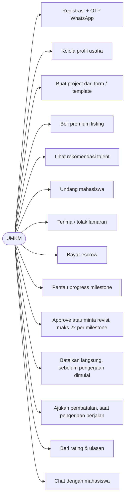
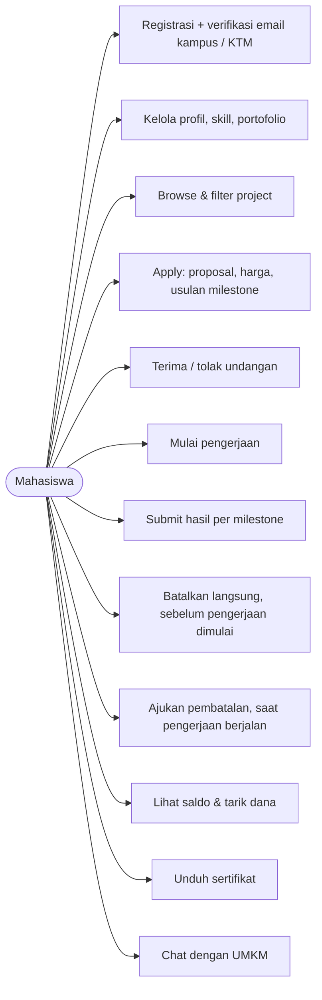
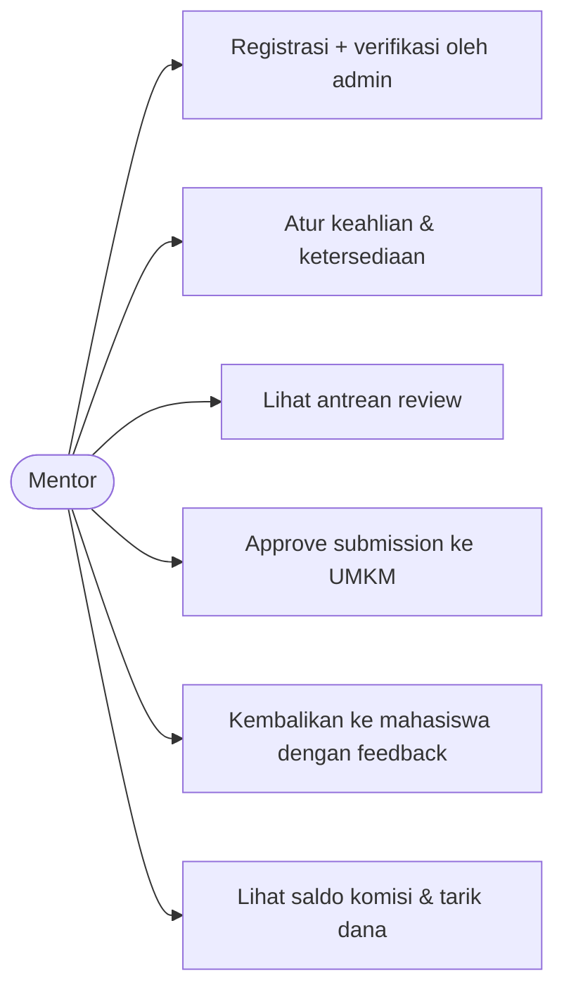
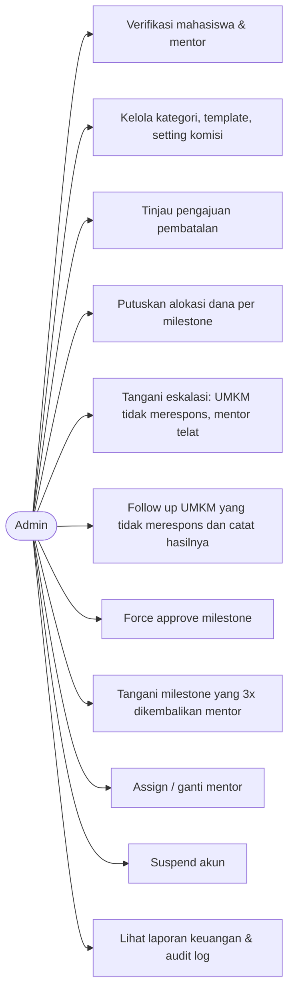
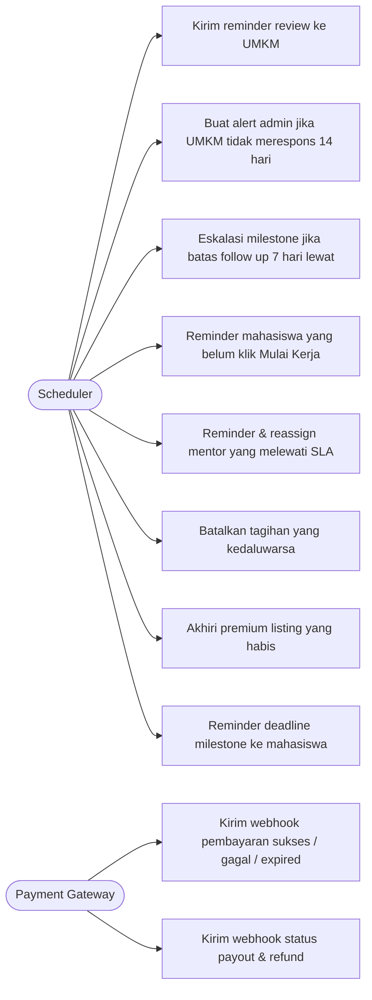

# 02 — Use Case per Aktor

Mermaid tidak punya diagram use case UML resmi, jadi digambarkan dengan flowchart. Satu diagram per aktor agar mudah dibaca.

## Aktor

| Aktor | Peran |
|---|---|
| UMKM | Klien yang memposting project dan membayar |
| Mahasiswa | Talenta yang mengerjakan project |
| Mentor | Senior/dosen yang meninjau hasil kerja per milestone (dibayar komisi) |
| Admin | Verifikasi, menangani pembatalan, eskalasi, dan pencairan manual |
| System (Scheduler) | Aktor otomatis: reminder, timeout, eskalasi |
| Payment Gateway | Sistem eksternal pembayaran & disbursement |

## UMKM

## Mahasiswa

## Mentor

## Admin

## System (Scheduler) & Payment Gateway

