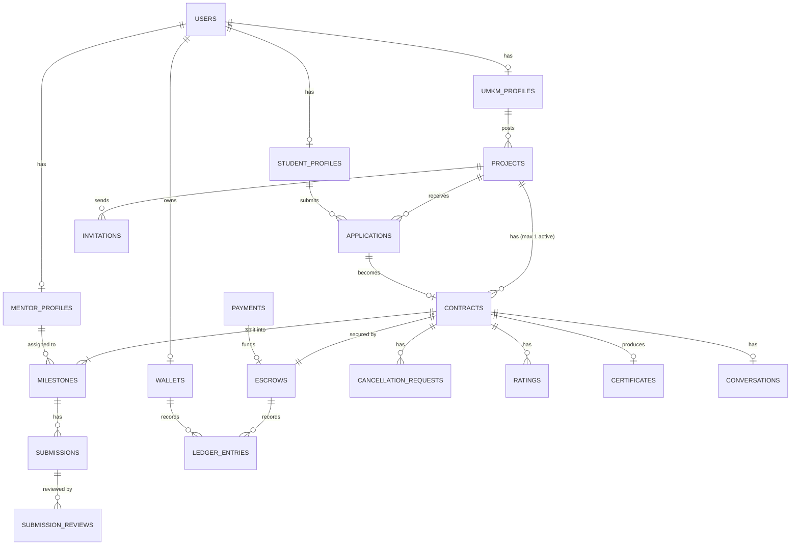
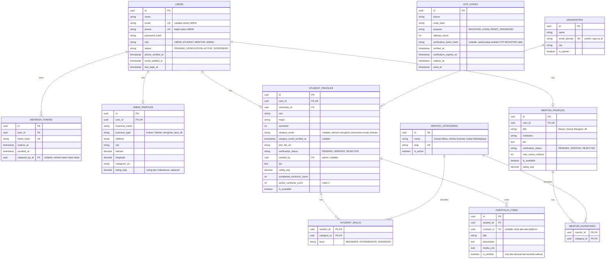
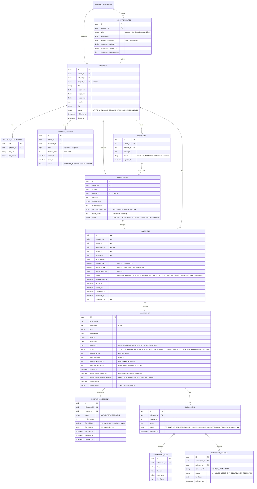

# 03 — Entity Relationship Diagram (ERD)

ERD dibagi menjadi 5 bagian supaya terbaca. Bagian 0 adalah peta relasi tingkat tinggi; bagian 1–4 berisi atribut detail.

Konvensi:
- Semua `id` bertipe `uuid`.
- Semua tabel punya `created_at` dan `updated_at` (tidak ditulis ulang agar ringkas).
- Uang disimpan sebagai `bigint` dalam Rupiah.
- Kolom `status` adalah enum; nilainya mengikuti `04-state-diagram.md`.

---

## 0. Peta Relasi (Overview)

---

## 1. Users, Profil & Verifikasi

---

## 2. Project, Lamaran & Kontrak

**Catatan aturan bisnis di level data:**
- `SUM(milestones.amount) = contracts.total_amount` — divalidasi saat kontrak dibuat.
- Satu project hanya boleh punya **satu** kontrak dengan status aktif (`AWAITING_PAYMENT`, `FUNDED`, `IN_PROGRESS`, `CANCELLATION_REQUESTED`). Gunakan partial unique index.
- Milestone dikerjakan **berurutan**: milestone ke-2 baru `IN_PROGRESS` setelah milestone ke-1 `APPROVED`.
- Mahasiswa maksimal **2 kontrak aktif**. Saat UMKM menerima lamaran, lock baris `student_profiles` (`SELECT ... FOR UPDATE`) lalu hitung ulang kontrak aktif, supaya dua UMKM yang menerima di waktu bersamaan tidak membuat mahasiswa punya 3 kontrak.
- Setiap milestone minimal **Rp 150.000**.

---

## 3. Keuangan: Payment, Escrow, Ledger, Payout

```mermaid
erDiagram
    PAYMENTS {
        uuid id PK
        uuid payer_id FK
        string purpose "ESCROW_FUNDING, PREMIUM_LISTING"
        uuid reference_id "contract_id atau premium_listing_id"
        bigint amount
        bigint gateway_fee
        string gateway "MIDTRANS, XENDIT"
        string gateway_ref UK "untuk idempotensi webhook"
        string method "VA, QRIS, EWALLET"
        string status "PENDING, PAID, FAILED, EXPIRED, REFUNDED"
        timestamp expires_at
        timestamp paid_at
    }

    PAYMENT_WEBHOOK_LOGS {
        uuid id PK
        string gateway
        string gateway_ref
        string event_type
        json payload
        boolean processed
        timestamp received_at
    }

    ESCROWS {
        uuid id PK
        uuid contract_id FK, UK
        uuid payment_id FK
        bigint funded_amount
        bigint released_amount
        bigint refunded_amount
        bigint held_amount "funded - released - refunded"
        string status "PENDING_FUNDING, HELD, PARTIALLY_RELEASED, RELEASED, REFUNDED, SETTLED"
    }

    WALLETS {
        uuid id PK
        uuid user_id FK "nullable untuk akun sistem"
        string type "STUDENT, MENTOR, UMKM_REFUND, PLATFORM_REVENUE"
        bigint balance "cache, sumber kebenaran adalah ledger"
        bigint pending_withdrawal
    }

    LEDGER_TRANSACTIONS {
        uuid id PK
        string type "ESCROW_FUNDED, MILESTONE_RELEASE, REFUND, WITHDRAWAL, PREMIUM_LISTING"
        string reference_type "MILESTONE, CONTRACT, PAYOUT, CANCELLATION"
        uuid reference_id
        string idempotency_key UK
        text description
    }

    LEDGER_ENTRIES {
        uuid id PK
        uuid transaction_id FK
        string account_type "ESCROW, WALLET"
        uuid escrow_id FK "nullable"
        uuid wallet_id FK "nullable"
        string direction "DEBIT, CREDIT"
        bigint amount
    }

    MILESTONE_SETTLEMENTS {
        uuid id PK
        uuid milestone_id FK, UK
        bigint gross_amount
        bigint platform_fee
        bigint mentor_fee
        bigint platform_net
        bigint student_amount
        bigint refund_amount "jika ada pembatalan"
        uuid ledger_transaction_id FK
        timestamp settled_at
    }

    BANK_ACCOUNTS {
        uuid id PK
        uuid user_id FK
        string channel "BANK, EWALLET"
        string provider_code "BCA, BRI, DANA, OVO, GOPAY"
        string account_number "dienkripsi (cast encrypted)"
        string account_number_last4 "teknis: ditampilkan ke klien"
        string account_holder_name
        boolean is_verified
        boolean is_primary
    }

    PAYOUTS {
        uuid id PK
        uuid wallet_id FK
        uuid bank_account_id FK
        bigint amount
        bigint fee "biaya transfer, ditanggung penarik"
        bigint net_amount "amount - fee, yang diterima di rekening"
        string status "REQUESTED, PROCESSING, SUCCESS, FAILED"
        string gateway_ref UK
        timestamp requested_at
        timestamp completed_at
    }

    REFUNDS {
        uuid id PK
        uuid payment_id FK
        uuid cancellation_request_id FK "nullable"
        bigint amount "nilai project saja, biaya gateway tidak dikembalikan"
        string status "PENDING, PROCESSING, SUCCESS, FAILED"
        string gateway_ref UK
    }

    PAYMENTS ||--o{ PAYMENT_WEBHOOK_LOGS : logs
    PAYMENTS ||--o| ESCROWS : funds
    PAYMENTS ||--o{ REFUNDS : "refunded by"
    ESCROWS ||--o{ LEDGER_ENTRIES : records
    WALLETS ||--o{ LEDGER_ENTRIES : records
    LEDGER_TRANSACTIONS ||--|{ LEDGER_ENTRIES : contains
    MILESTONE_SETTLEMENTS ||--|| LEDGER_TRANSACTIONS : "posted as"
    WALLETS ||--o{ PAYOUTS : withdraws
    BANK_ACCOUNTS ||--o{ PAYOUTS : receives
```

**Kenapa pakai ledger?** Saldo (`wallets.balance`, `escrows.held_amount`) hanya *cache*. Sumber kebenaran adalah `LEDGER_ENTRIES`, di mana setiap transaksi wajib seimbang: `total DEBIT = total CREDIT`. Ini membuat audit dan rekonsiliasi dengan payment gateway jauh lebih mudah. Contoh jurnal ada di `06-alur-keuangan-escrow.md`.

---

## 4. Pembatalan, Rating, Sertifikat, Chat, Notifikasi, Admin

```mermaid
erDiagram
    CANCELLATION_REQUESTS {
        uuid id PK
        uuid contract_id FK
        uuid requested_by FK
        string requester_role "UMKM, STUDENT, ADMIN (terminasi langsung oleh admin)"
        string type "DIRECT, NEEDS_REVIEW"
        text reason
        json evidence_urls
        text counterparty_response
        string status "PENDING, APPROVED, REJECTED, WITHDRAWN"
        uuid resolved_by FK "admin"
        text admin_notes
        timestamp response_due_at
        timestamp resolved_at
    }

    CANCELLATION_ALLOCATIONS {
        uuid id PK
        uuid cancellation_request_id FK
        uuid milestone_id FK
        bigint amount_to_student
        bigint amount_to_umkm
        bigint mentor_fee "total fee mentor yang fee_eligible, ditanggung platform jika dana di-refund"
    }

    RATINGS {
        uuid id PK
        uuid contract_id FK
        uuid rater_id FK
        uuid ratee_id FK
        string direction "UMKM_TO_STUDENT, STUDENT_TO_UMKM, STUDENT_TO_MENTOR. UMKM tidak menilai mentor"
        int score "1 sampai 5"
        text comment
    }

    CERTIFICATES {
        uuid id PK
        uuid contract_id FK, UK
        uuid student_id FK
        string certificate_no UK
        string verification_code UK "untuk URL verifikasi publik"
        string pdf_url
        timestamp issued_at
    }

    CONVERSATIONS {
        uuid id PK
        uuid project_id FK
        uuid contract_id FK "nullable sebelum kontrak"
        uuid umkm_user_id FK
        uuid student_user_id FK
    }

    MESSAGES {
        uuid id PK
        uuid conversation_id FK
        uuid sender_id FK
        text body
        string attachment_url
        boolean is_flagged "deteksi nomor HP / ajakan transaksi di luar"
        timestamp read_at
    }

    NOTIFICATIONS {
        uuid id PK
        uuid user_id FK
        string type "APPLICATION_RECEIVED, PAYMENT_SUCCESS, REVIEW_REMINDER, dll"
        string title
        text body
        json data
        string channels "IN_APP, WHATSAPP, EMAIL"
        timestamp sent_at
        timestamp read_at
    }

    ADMIN_ALERTS {
        uuid id PK
        string type "UMKM_UNRESPONSIVE, MENTOR_OVERDUE, STUDENT_OVERDUE, STUDENT_NOT_STARTED, CANCELLATION_REQUEST, REVISION_LIMIT_DISPUTE, MENTOR_RETURN_LIMIT"
        string severity "LOW, MEDIUM, HIGH"
        string reference_type
        uuid reference_id
        string status "OPEN, FOLLOWED_UP, AWAITING_DECISION, RESOLVED"
        uuid assigned_to FK
        timestamp follow_up_deadline "follow up pertama + 7 hari"
        text resolution_notes
        timestamp resolved_at
    }

    ALERT_FOLLOW_UPS {
        uuid id PK
        uuid alert_id FK
        uuid admin_id FK
        string channel "WHATSAPP, TELEPON, EMAIL"
        string outcome "TIDAK_DIANGKAT, DIJAWAB_AKAN_REVIEW, DIJAWAB_MENOLAK, LAINNYA"
        text notes
        timestamp followed_up_at
    }

    PLATFORM_SETTINGS {
        string key PK "daftar lengkap di README"
        string value
        text description
    }

    AUDIT_LOGS {
        uuid id PK
        uuid actor_id FK
        string action
        string entity_type
        uuid entity_id
        json before_data
        json after_data
        string ip_address
        timestamp created_at
    }

    CANCELLATION_REQUESTS ||--o{ CANCELLATION_ALLOCATIONS : "decides"
    ADMIN_ALERTS ||--o{ ALERT_FOLLOW_UPS : "followed up by"
    CONVERSATIONS ||--o{ MESSAGES : contains
```

