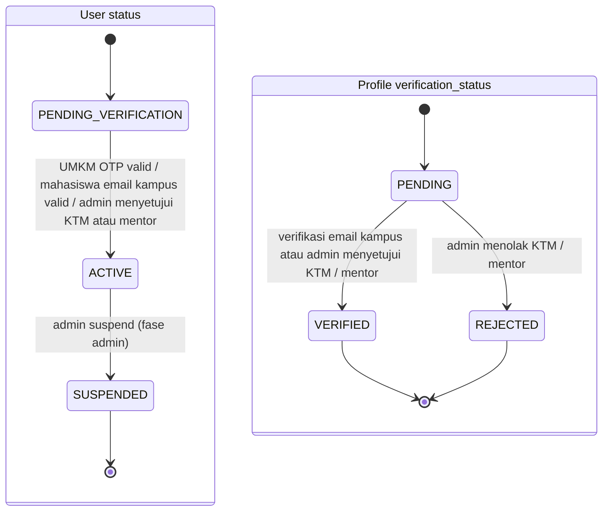
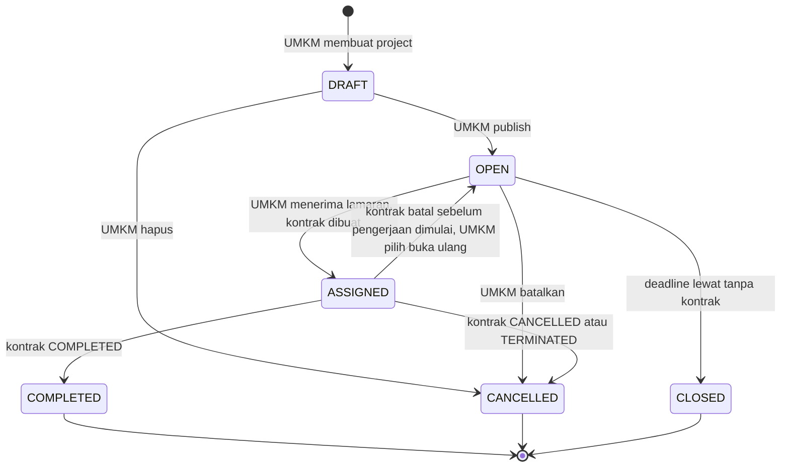
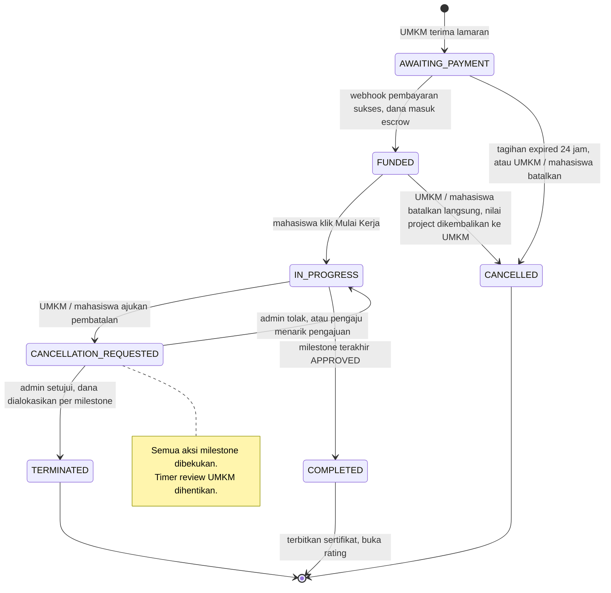
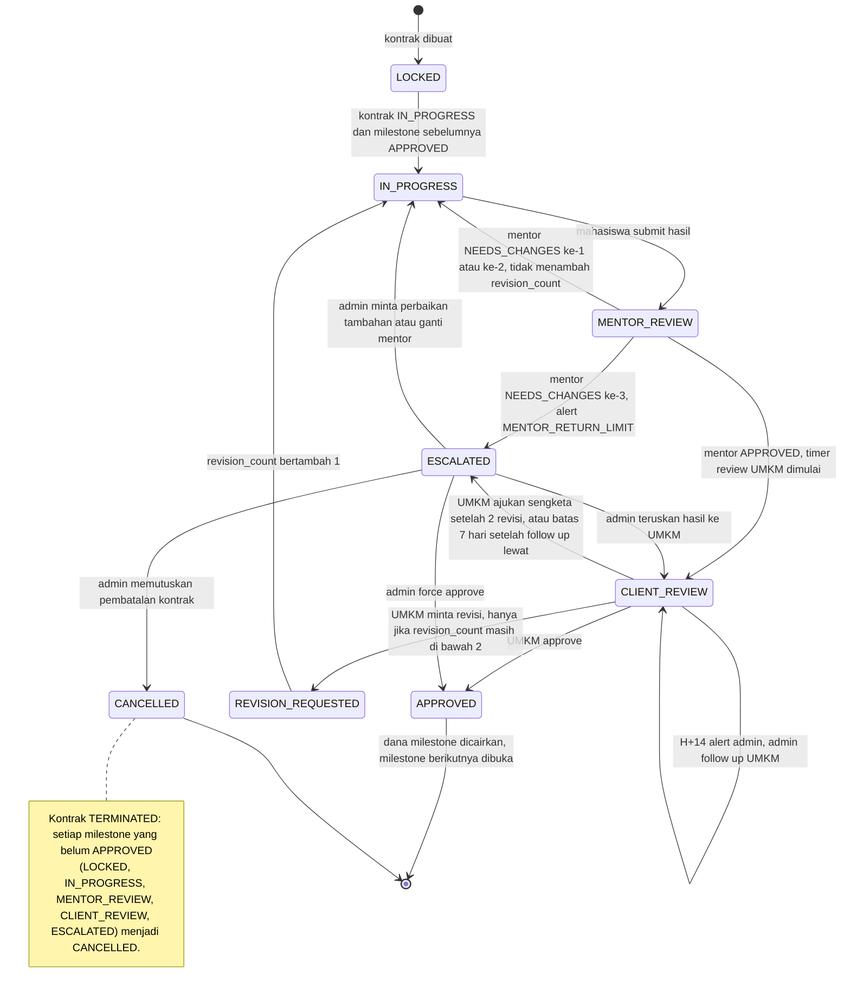
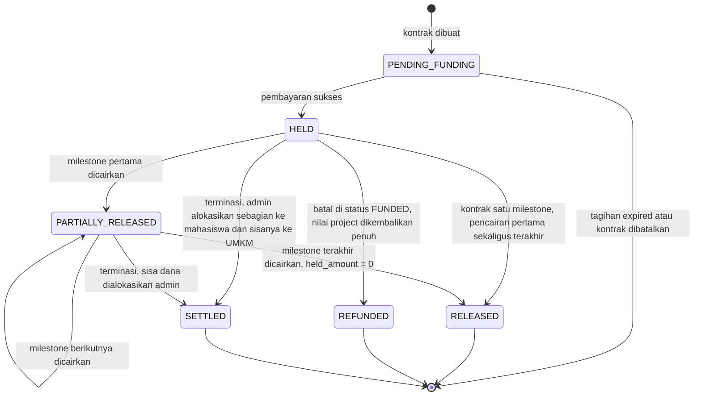
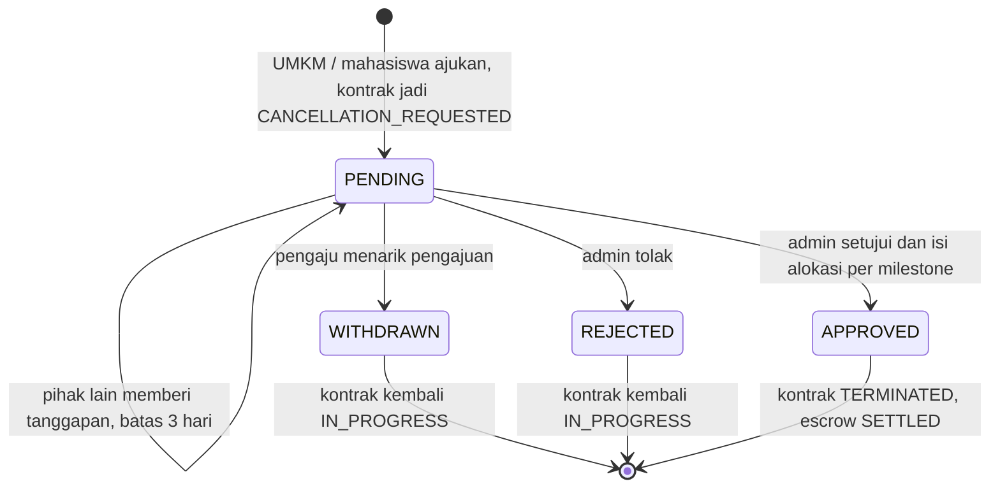
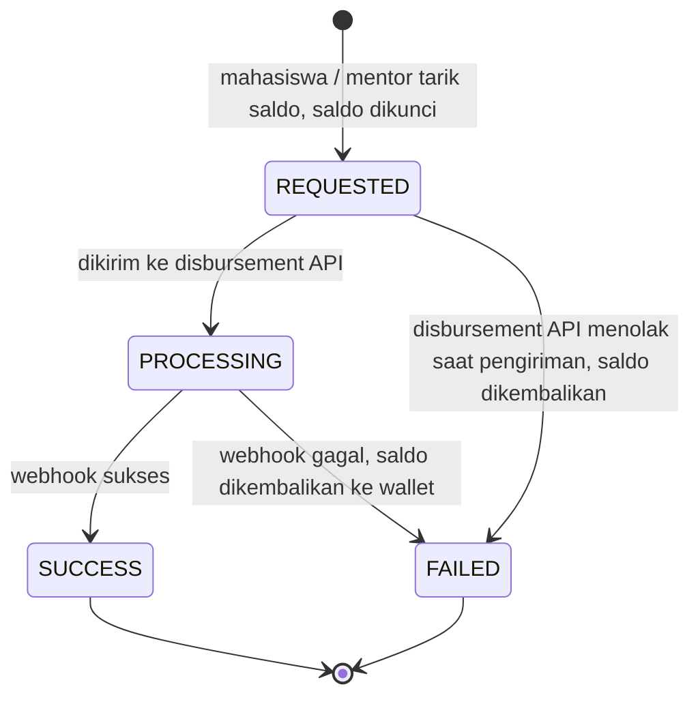
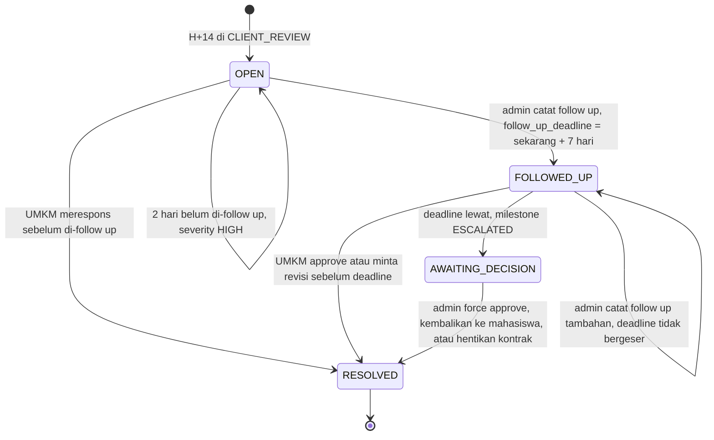
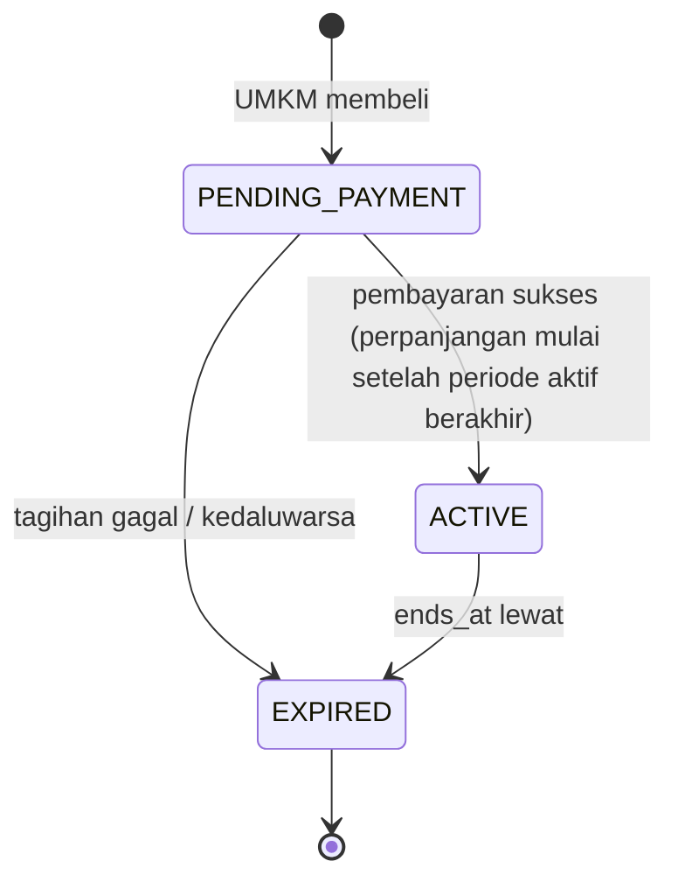
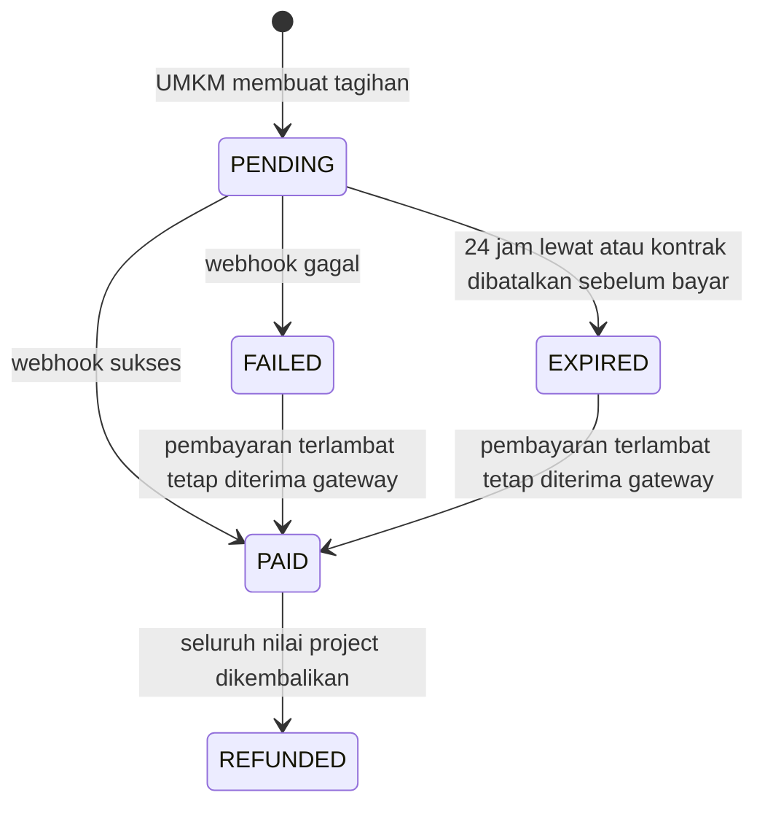

# 04 — State Diagram (State Machine)

Ini bagian paling penting untuk backend. Setiap endpoint yang mengubah status **wajib** mengecek bahwa transisinya ada di diagram ini; jika tidak ada, tolak dengan `409 Conflict`.

## 0. Akun & Verifikasi Profil



Aturan fase auth: UMKM menjadi `ACTIVE` setelah nomor telepon terverifikasi OTP. Mahasiswa dengan email kampus menjadi `ACTIVE` setelah tautan verifikasi sekali pakai yang berlaku 60 menit dibuka; mahasiswa tanpa email kampus dan mentor menunggu keputusan admin. Status profil mahasiswa/mentor bergerak dari `PENDING` ke `VERIFIED` atau `REJECTED` hanya melalui state machine.

Access token berlaku 15 menit. Refresh token acak disimpan sebagai hash, berlaku 30 hari, dirotasi saat digunakan, dan token lama tidak dapat digunakan ulang.

---

## 1. Project

Project adalah "lowongan". Pengerjaan sebenarnya dilacak di **Contract**.



---

## 2. Contract (Siklus Pengerjaan)

Definisi **"pengerjaan sudah berjalan"** = kontrak berstatus `IN_PROGRESS`, yaitu **hanya** setelah mahasiswa menekan tombol **Mulai Kerja**. Tidak ada auto-start.



| Status | Bisa dibatalkan langsung? | Uang |
|---|---|---|
| `AWAITING_PAYMENT` | Ya | Belum ada |
| `FUNDED` | Ya | Nilai project dikembalikan penuh ke UMKM. Biaya gateway tidak dikembalikan |
| `IN_PROGRESS` | Tidak, harus ajukan ke admin | Dialokasikan admin per milestone. Mentor yang sudah review tetap dibayar |

Jika dibatalkan di `FUNDED` (oleh UMKM **atau** mahasiswa), dana dikembalikan ke UMKM. Project kembali `OPEN` jika UMKM memilih membuka ulang, dan UMKM membayar lagi saat menerima mahasiswa baru.

---

## 3. Milestone (dengan Mentor Review & Batas Revisi)

Aturan:
- Setiap submission **selalu** melewati mentor sebelum ke UMKM, termasuk submission hasil revisi.
- Mentor mengembalikan pekerjaan (`NEEDS_CHANGES`) **tidak** dihitung sebagai revisi UMKM.
- UMKM punya **maks 2 revisi per milestone**. Setelah revisi ke-2 disubmit, UMKM hanya bisa **Approve** atau **Ajukan Sengketa** ke admin.
- Jika UMKM tidak merespons di `CLIENT_REVIEW` selama 14 hari, admin mendapat alert dan wajib **follow up**. Milestone **tetap** `CLIENT_REVIEW` selama 7 hari setelah follow up, jadi UMKM masih bisa approve/minta revisi. Baru setelah batas itu lewat, milestone `ESCALATED` dan admin memutuskan (lihat `07-scheduler-dan-notifikasi.md`).
- Mentor maksimal mengembalikan pekerjaan **3 kali per milestone**. Pengembalian ke-3 membuat milestone `ESCALATED` dengan alert `MENTOR_RETURN_LIMIT`. Admin bisa memberi kesempatan tambahan, mengganti mentor, meneruskan hasil ke UMKM, atau memproses pembatalan.
- Begitu mentor menyelesaikan review pertama, `mentor_assignments.fee_eligible = true`. Mentor tetap dibayar walau milestone kemudian dibatalkan atau mentornya diganti.



**Pseudocode guard untuk "minta revisi":**

```text
function requestRevision(milestone, umkm):
    assert milestone.status == CLIENT_REVIEW
    assert milestone.contract.status == IN_PROGRESS
    assert milestone.revision_count < milestone.max_revisions   // max_revisions = 2
    milestone.revision_count += 1
    milestone.status = REVISION_REQUESTED -> IN_PROGRESS
    cancel scheduled reminder jobs untuk milestone ini
```

**Pseudocode untuk "mentor review":**

```text
function mentorReview(submission, mentor, decision):
    milestone = submission.milestone
    assert milestone.status == MENTOR_REVIEW
    assignment = active mentor_assignment milestone ini
    assert assignment.mentor_id == mentor.id
    assignment.review_count += 1
    assignment.fee_eligible = true                      // mentor tetap dibayar walau nanti batal

    if decision == APPROVED:
        milestone.status = CLIENT_REVIEW
        milestone.client_review_started_at = now()
        schedule reminder H+3, H+7, H+10 dan alert admin H+14
    else:  // NEEDS_CHANGES
        milestone.mentor_return_count += 1
        if milestone.mentor_return_count >= milestone.max_mentor_returns:   // 3
            milestone.status = ESCALATED
            create admin_alert MENTOR_RETURN_LIMIT
        else:
            milestone.status = IN_PROGRESS
```

Saat admin memberi kesempatan tambahan atau mengganti mentor, `mentor_return_count` direset ke 0. Mengganti mentor = assignment lama jadi `REPLACED` dan dibuat assignment baru. Mentor lama tetap dibayar jika `fee_eligible = true`, jadi milestone itu bisa punya dua fee mentor. Selisihnya ditanggung platform.

---

## 4. Escrow



Invariant yang harus selalu benar:

```text
escrow.held_amount = funded_amount - released_amount - refunded_amount
escrow.held_amount >= 0
```

---

## 5. Cancellation Request



---

## 6. Payout (Penarikan Saldo)



---

## 7. Admin Alert: UMKM Tidak Merespons



Guard: endpoint `force-approve` untuk kasus UMKM tidak merespons hanya boleh dipanggil saat alert berstatus `AWAITING_DECISION`, yaitu setelah follow up tercatat **dan** batas 7 hari sudah lewat.

Alert tipe lain (`MENTOR_OVERDUE`, `MENTOR_RETURN_LIMIT`, `REVISION_LIMIT_DISPUTE`, `STUDENT_OVERDUE`, `STUDENT_NOT_STARTED`, `CANCELLATION_REQUEST`) tidak punya follow up: `OPEN → AWAITING_DECISION` (misal batas tanggapan pembatalan 3 hari lewat) `→ RESOLVED`, atau langsung `OPEN → RESOLVED` saat admin memutuskan / pihak terkait merespons.

## 8. Premium Listing



## 9. Payment



Pembayaran terlambat untuk kontrak yang sudah batal tidak mendanai escrow; nilai project langsung di-refund otomatis (biaya gateway tidak).
