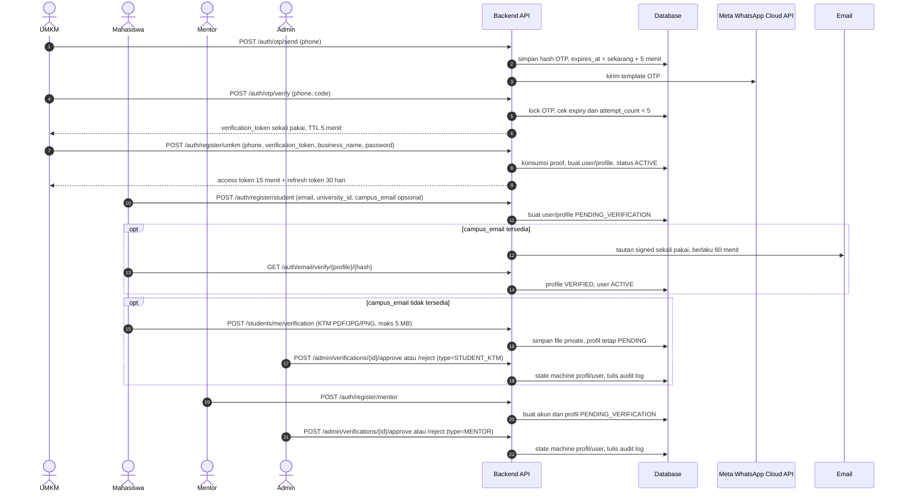
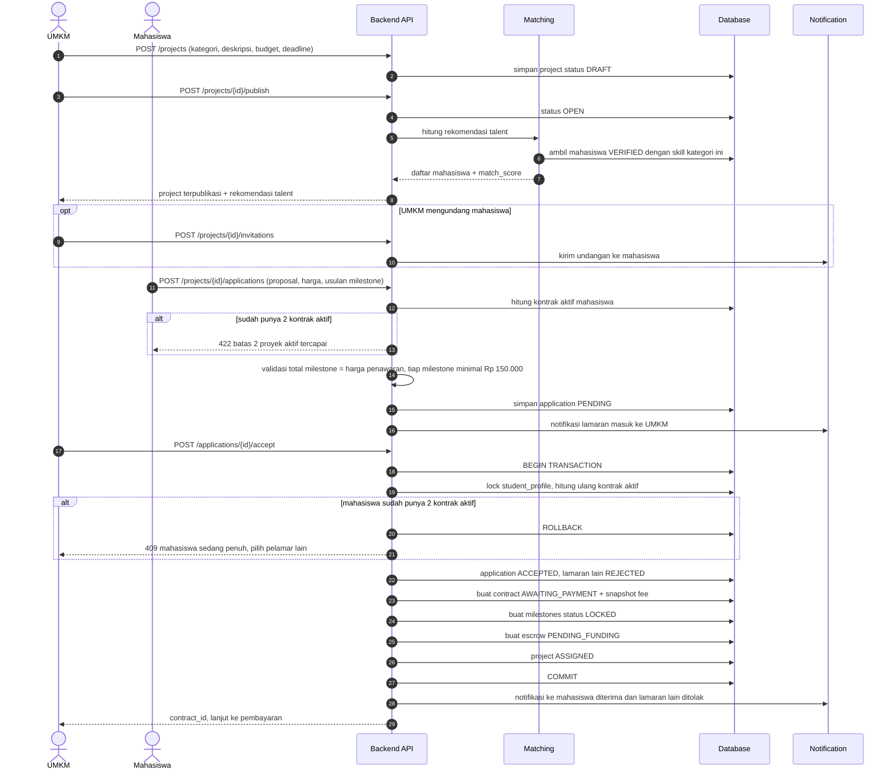
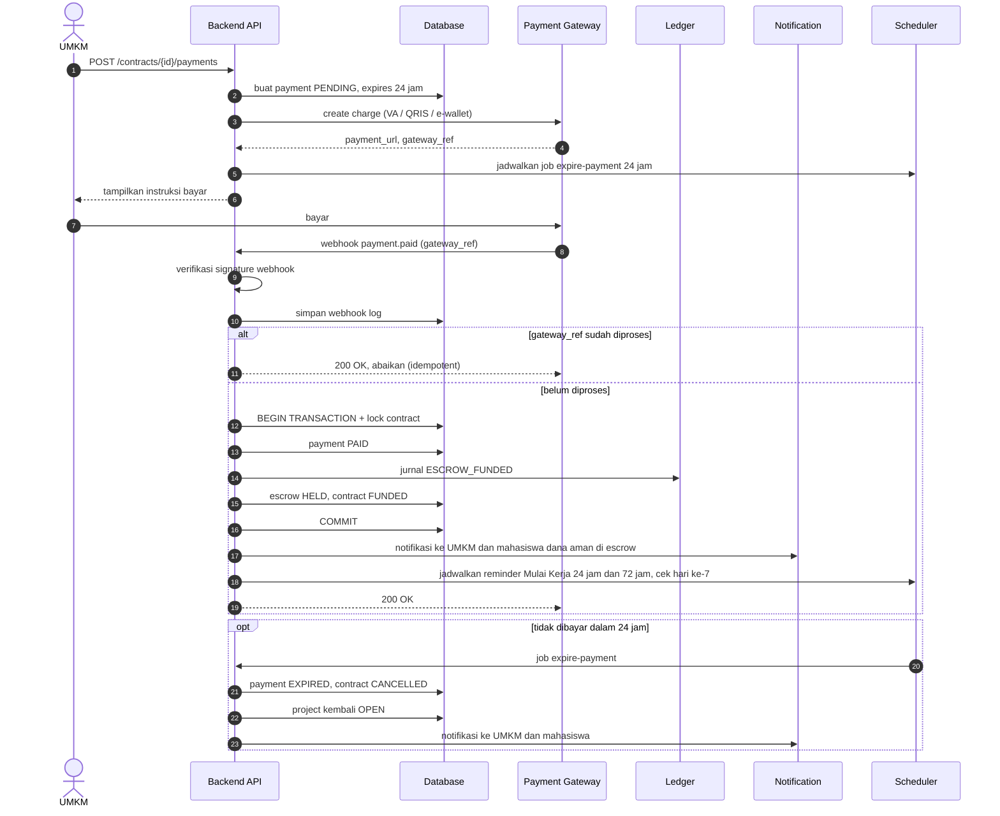
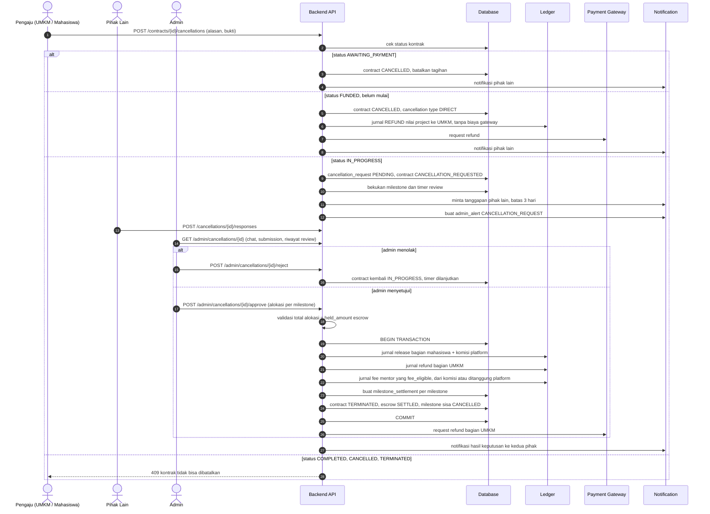
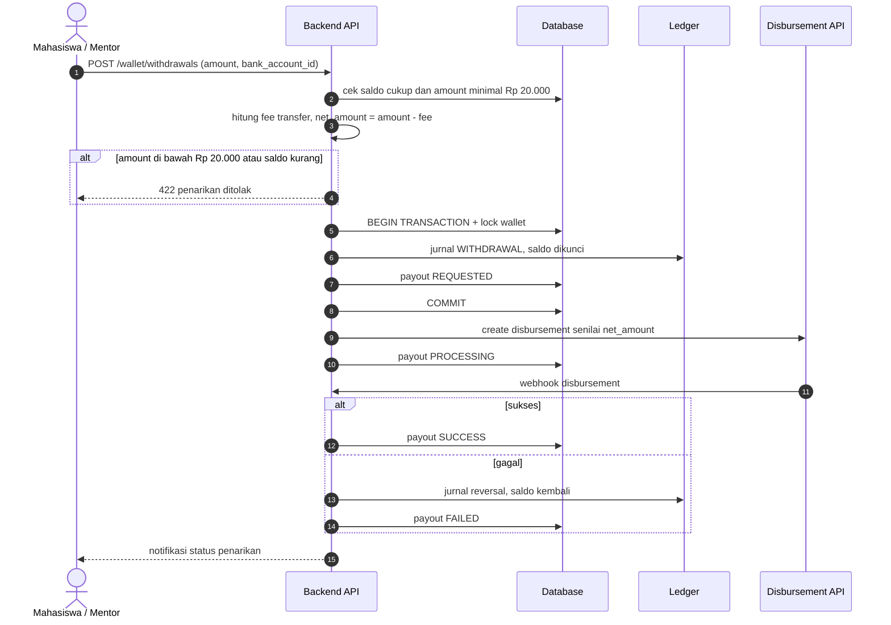
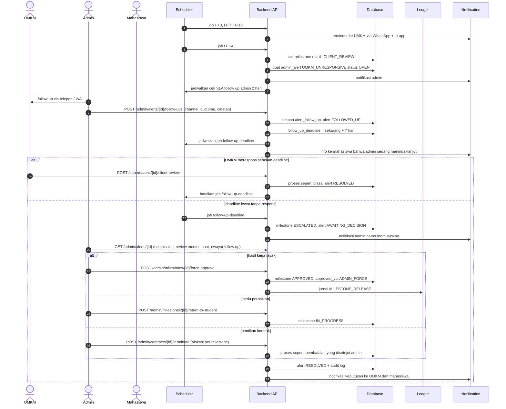

# 05 — Sequence Diagram

Alur utama dari awal sampai akhir, dipecah menjadi 6 bagian.

---

## 0. Auth & Verifikasi

---

## 1. Posting Project → Lamaran → Kontrak

---

## 2. Pembayaran Escrow (Funding)

---

## 3. Pengerjaan Milestone: Submit → Mentor → UMKM → Pencairan

```mermaid
sequenceDiagram
    autonumber
    actor M as Mahasiswa
    actor T as Mentor
    actor U as UMKM
    participant API as Backend API
    participant DB as Database
    participant L as Ledger
    participant N as Notification
    participant J as Scheduler

    M->>API: POST /contracts/{id}/start
    API->>DB: contract IN_PROGRESS, milestone 1 IN_PROGRESS
    API->>API: assign mentor sesuai kategori dan beban review
    API->>N: notifikasi UMKM pengerjaan dimulai

    loop setiap submission
        M->>API: POST /milestones/{id}/submissions (file, catatan)
        API->>DB: simpan submission version N, milestone MENTOR_REVIEW
        API->>N: notifikasi mentor
        API->>J: jadwalkan SLA mentor 48 jam

        T->>API: POST /submissions/{id}/mentor-review
        API->>DB: mentor_assignment fee_eligible = true
        alt mentor NEEDS_CHANGES ke-1 atau ke-2
            API->>DB: mentor_return_count +1, milestone IN_PROGRESS, revision_count tetap
            API->>N: feedback mentor ke mahasiswa
        else mentor NEEDS_CHANGES ke-3
            API->>DB: milestone ESCALATED
            API->>N: admin_alert MENTOR_RETURN_LIMIT
            API->>N: info ke mahasiswa bahwa admin akan meninjau
        else mentor APPROVED
            API->>DB: milestone CLIENT_REVIEW, catat client_review_started_at
            API->>N: notifikasi UMKM hasil siap direview
            API->>J: jadwalkan reminder H+3, H+7, H+10, alert admin H+14

            U->>API: POST /submissions/{id}/client-review
            alt UMKM minta revisi dan revision_count di bawah 2
                API->>DB: revision_count +1, milestone IN_PROGRESS
                API->>J: batalkan reminder
                API->>N: notifikasi mahasiswa ada revisi
            else UMKM minta revisi tapi sudah 2 kali
                API-->>U: 422 batas revisi habis, pilih Approve atau Ajukan Sengketa
            else UMKM approve
                API->>J: batalkan reminder
                API->>DB: BEGIN TRANSACTION + lock escrow
                API->>DB: milestone APPROVED
                API->>L: jurnal MILESTONE_RELEASE: mahasiswa, mentor, platform
                API->>DB: simpan milestone_settlement, update escrow
                API->>DB: buka milestone berikutnya IN_PROGRESS
                API->>DB: COMMIT
                API->>N: notifikasi mahasiswa dan mentor saldo masuk
            end
        end
    end

    Note over U,J: Jika UMKM diam, lihat alur follow up admin di bagian 6
    Note over API,DB: Jika milestone terakhir APPROVED
    API->>DB: contract COMPLETED, project COMPLETED, escrow RELEASED
    API->>DB: terbitkan certificate + portfolio_item terverifikasi
    API->>N: minta UMKM dan mahasiswa memberi rating
```

---

## 4. Pembatalan

---

## 5. Penarikan Saldo (Payout)

---

## 6. UMKM Tidak Merespons → Follow Up Admin → Keputusan Admin

