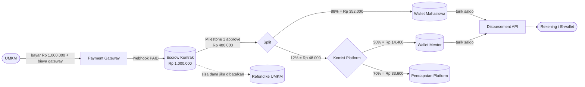

# 06 — Alur Keuangan, Escrow & Komisi Mentor

## 1. Model Uang (Sudah Dikonfirmasi)

| Parameter | Nilai default | Disimpan di |
|---|---|---|
| Komisi platform | 12% dari nilai milestone (bisa diatur 10–15%) | `platform_settings.platform_fee_pct` |
| Porsi mentor | 30% dari komisi platform | `platform_settings.mentor_share_pct` |
| Fee minimum mentor | Rp 10.000 per milestone | `platform_settings.mentor_min_fee` |
| Nilai minimum per milestone | Rp 150.000 | `platform_settings.min_milestone_amount` |
| Yang menanggung komisi | Dipotong dari bagian mahasiswa. UMKM membayar sesuai harga yang disepakati | — |
| Biaya payment gateway | Ditanggung UMKM, tampil sebagai "biaya layanan pembayaran". **Tidak dikembalikan** saat refund | — |
| Minimum penarikan saldo | Rp 20.000 | `platform_settings.min_withdrawal_amount` |
| Biaya transfer saat tarik saldo | Ditanggung penarik, dipotong dari jumlah yang ditarik | `platform_settings.withdrawal_fee` |
| Premium listing | Rp 50.000 untuk 30 hari | `premium_listing_price`, `premium_listing_days` |

Komisi baru diakui **saat milestone dicairkan**. Bagian yang di-refund ke UMKM **tidak** dipotong komisi.

**Mentor tetap dibayar walau milestone dibatalkan**, asalkan sudah menyelesaikan minimal satu review di milestone itu. Jika dana milestone di-refund ke UMKM, fee mentor ditanggung dari pendapatan platform.

---

## 2. Aliran Dana



Milestone 2 (Rp 600.000) mengikuti pola split yang sama saat disetujui.

---

## 3. Contoh Jurnal Ledger (Double-Entry)

Proyek Rp 1.000.000, milestone 1 = Rp 400.000, milestone 2 = Rp 600.000.

**a. UMKM membayar (ESCROW_FUNDED)**

| Akun | Debit | Kredit |
|---|---:|---:|
| Gateway Clearing | 1.000.000 | |
| Escrow Kontrak | | 1.000.000 |

**b. Milestone 1 disetujui (MILESTONE_RELEASE)**

| Akun | Debit | Kredit |
|---|---:|---:|
| Escrow Kontrak | 400.000 | |
| Wallet Mahasiswa | | 352.000 |
| Wallet Mentor | | 14.400 |
| Pendapatan Platform | | 33.600 |

**c. Kontrak dihentikan admin, milestone 2 di-refund penuh, mentor sudah sempat review (REFUND)**

Fee mentor milestone 2 = 30% × (12% × 600.000) = Rp 21.600, ditanggung platform.

| Akun | Debit | Kredit |
|---|---:|---:|
| Escrow Kontrak | 600.000 | |
| UMKM Refund Payable | | 600.000 |
| Pendapatan Platform | 21.600 | |
| Wallet Mentor | | 21.600 |

**d. Mahasiswa menarik saldo (WITHDRAWAL)**

Contoh biaya transfer Rp 2.500 (angka sebenarnya mengikuti tarif gateway). Mahasiswa menerima Rp 349.500.

| Akun | Debit | Kredit |
|---|---:|---:|
| Wallet Mahasiswa | 352.000 | |
| Payout Clearing | | 349.500 |
| Biaya Transfer Payable | | 2.500 |

**e. Penarikan gagal (WITHDRAWAL reversal)** — saldo kembali ke wallet.

| Akun | Debit | Kredit |
|---|---:|---:|
| Payout Clearing | 349.500 | |
| Biaya Transfer Payable | 2.500 | |
| Wallet Mahasiswa | | 352.000 |

Saat penarikan dibuat, saldo langsung berkurang dan dicatat di `wallets.pending_withdrawal` sampai disbursement SUCCESS/FAILED.

**f. Premium listing dibayar (PREMIUM_LISTING)**

| Akun | Debit | Kredit |
|---|---:|---:|
| Gateway Clearing | 50.000 | |
| Pendapatan Platform | | 50.000 |

**g. Refund dikirim gateway** (setelah jurnal REFUND ke UMKM Refund Payable)

| Akun | Debit | Kredit |
|---|---:|---:|
| UMKM Refund Payable | 600.000 | |
| Gateway Clearing | | 600.000 |

Aturan: setiap `ledger_transaction` harus seimbang (total debit = total kredit). Jika tidak seimbang, rollback.

---

## 4. Rumus Pencairan per Milestone

```text
platform_fee  = round(milestone.amount * contract.platform_fee_pct / 100)
mentor_fee    = max(contract.mentor_min_fee,
                    round(platform_fee * contract.mentor_share_pct / 100))
mentor_fee    = min(mentor_fee, platform_fee)        // platform tidak boleh rugi
platform_net  = platform_fee - mentor_fee
student_amount = milestone.amount - platform_fee
```

**Saat pembatalan (admin mengisi `amount_to_student` dan `amount_to_umkm` per milestone):**

```text
platform_fee   = round(amount_to_student * platform_fee_pct / 100)
student_amount = amount_to_student - platform_fee
refund_amount  = amount_to_umkm

// fee mentor dihitung dari nilai PENUH milestone, untuk setiap assignment yang fee_eligible
mentor_fee_total = sum(fee mentor per assignment fee_eligible)
platform_net     = platform_fee - mentor_fee_total      // boleh negatif, ditanggung platform

assert amount_to_student + amount_to_umkm == bagian milestone yang masih ditahan escrow
```

**Saat tarik saldo:**

```text
assert amount >= min_withdrawal_amount        // Rp 20.000
assert amount <= wallet.balance
net_amount = amount - withdrawal_fee          // ditanggung penarik
assert net_amount > 0
```

---

## 5. Rekomendasi Komisi Mentor

**Rekomendasi: mentor mendapat 25–35% dari komisi platform (default 30%), dengan minimum Rp 10.000 per milestone.** Kalau dihitung dari nilai milestone, itu sekitar 3–4,5%.

Simulasi dengan komisi platform 12% dan porsi mentor 30%:

| Nilai milestone | Komisi platform (12%) | Mentor | Platform bersih* | Mahasiswa (88%) |
|---:|---:|---:|---:|---:|
| Rp 150.000 | Rp 18.000 | Rp 10.000 (minimum) | Rp 8.000 | Rp 132.000 |
| Rp 300.000 | Rp 36.000 | Rp 10.800 | Rp 25.200 | Rp 264.000 |
| Rp 500.000 | Rp 60.000 | Rp 18.000 | Rp 42.000 | Rp 440.000 |
| Rp 1.000.000 | Rp 120.000 | Rp 36.000 | Rp 84.000 | Rp 880.000 |
| Rp 2.000.000 | Rp 240.000 | Rp 72.000 | Rp 168.000 | Rp 1.760.000 |

\* Sebelum biaya operasional seperti biaya disbursement, server, dan WhatsApp API.

**Alasan:**
1. **Platform tetap memegang mayoritas komisi (65–75%).** Platform masih harus membiayai biaya transfer, server, notifikasi WA, dan admin.
2. **Fee minimum perlu ada.** Untuk milestone kecil, 30% dari komisi bisa hanya sekitar Rp 5.000 — tidak layak untuk 20–30 menit review. Karena itu ada **nilai minimum milestone Rp 150.000** agar fee minimum mentor tidak menghabiskan komisi platform.
3. **Mentor dibayar sekali per milestone, bukan per putaran review.** Ini mencegah mentor sengaja mengembalikan pekerjaan berkali-kali untuk menambah pendapatan.
4. **Untuk dosen, uang bukan satu-satunya motivasi.** Partisipasi bisa dikemas sebagai kegiatan **pengabdian masyarakat** (Tri Dharma), lengkap dengan surat keterangan dari platform. Ini bisa jadi daya tarik yang lebih kuat daripada nominal fee.

**Opsi lanjutan (setelah MVP):** tier mentor — Senior/Alumni 25%, Profesional/Dosen 35% — dan dosen hanya ditugaskan pada project bernilai besar.

> ⚠️ **Catatan legal:** Menahan dana pengguna (escrow) di Indonesia berkaitan dengan regulasi jasa pembayaran Bank Indonesia. Sebaiknya dana disimpan lewat fitur yang disediakan payment gateway berlisensi (balance / sub-account / escrow) daripada di rekening pribadi atau perusahaan biasa. Konsultasikan dengan ahli hukum sebelum peluncuran. Penghasilan mahasiswa dan mentor juga mungkin berdampak pajak (PPh) — perlu dicek ke konsultan pajak.
