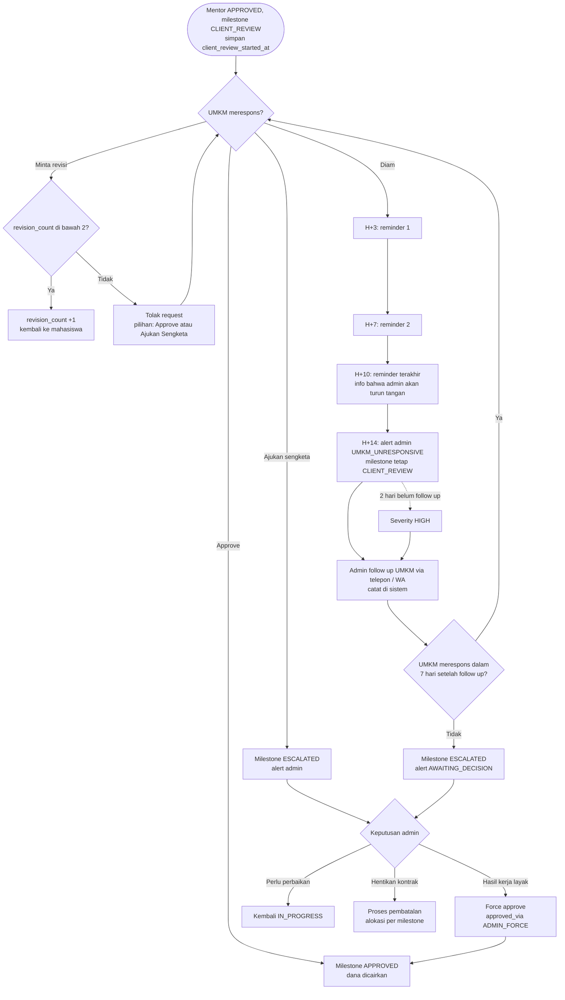

# 07 — Scheduler, Timeout & Eskalasi

Semua angka hari di bawah adalah default dan disimpan di `platform_settings`.

## 1. Daftar Job Terjadwal

| Job | Pemicu | Aksi |
|---|---|---|
| `expire-payment` | 24 jam setelah tagihan dibuat | Payment `EXPIRED`, kontrak `CANCELLED`, project kembali `OPEN` |
| `start-reminder` | 24 jam dan 72 jam setelah `FUNDED` | Reminder ke mahasiswa untuk klik Mulai Kerja. **Tidak ada auto-start** |
| `student-not-started` | Hari ke-7 setelah `FUNDED` | Info ke UMKM bahwa ia bisa batal langsung + alert admin `STUDENT_NOT_STARTED` (rekomendasi, belum dikonfirmasi) |
| `mentor-sla` | 48 jam di `MENTOR_REVIEW` | Reminder ke mentor. 72 jam: alert admin `MENTOR_OVERDUE` + opsi ganti mentor |
| `client-review-reminder` | H+3, H+7, H+10 di `CLIENT_REVIEW` | Reminder ke UMKM via WhatsApp + in-app |
| `umkm-unresponsive` | H+14 di `CLIENT_REVIEW` | Alert admin `UMKM_UNRESPONSIVE` severity MEDIUM. Milestone **tetap** `CLIENT_REVIEW` |
| `admin-followup-sla` | 2 hari setelah alert dibuat, belum ada follow up | Naikkan severity ke HIGH |
| `followup-deadline` | 7 hari setelah follow up pertama dicatat | Jika UMKM tetap diam: milestone `ESCALATED`, alert `AWAITING_DECISION` |
| `milestone-deadline` | H-2 dan H+0 due date | Reminder ke mahasiswa. H+3 lewat deadline: alert admin `STUDENT_OVERDUE` |
| `cancellation-response` | 3 hari setelah pengajuan | Tandai siap diputuskan admin walau pihak lain belum menanggapi |
| `premium-reminder` | 3 hari sebelum `ends_at` | Tawarkan perpanjangan ke UMKM |
| `premium-expire` | `premium_listings.ends_at` (30 hari setelah aktif) | Status `EXPIRED`, project keluar dari home page |
| `invitation-expire` | 3 hari setelah undangan | Status `EXPIRED` |

**Implementasi:** gunakan *delayed job* di queue (misal BullMQ di Node.js atau Laravel Queue) saat event terjadi, **ditambah** cron harian sebagai jaring pengaman yang memindai data yang terlewat. Setiap job harus mengecek ulang status sebelum bertindak, karena status bisa sudah berubah.

**Catatan implementasi (Fase 5):**
- Delayed job `ScheduledCheckJob` + cron `scheduler:sweep` (01:00 WIB) memanggil pengecekan yang sama di `SchedulerChecks`. `payments:expire-overdue` berjalan per jam.
- Setiap reminder/eskalasi dijalankan sekali lewat tabel teknis `scheduler_action_logs` (kunci unik per entitas, siklus, dan ambang). Siklus review baru (`client_review_started_at` baru) memulai reminder dari awal.
- "Membatalkan reminder" = job lama tidak berbuat apa-apa karena status/siklus sudah berubah saat dicek ulang.
- Timer milestone hanya berjalan saat kontrak `IN_PROGRESS`. Saat pengajuan pembatalan ditolak/ditarik, durasi jeda ditambahkan ke `milestones.client_review_paused_seconds` dan `follow_up_deadline` digeser.
- `cancellation-response`: 3 hari setelah pengajuan, alert `CANCELLATION_REQUEST` → AWAITING_DECISION dan admin diberi tahu.
- Aturan berbasis tanggal (due date milestone, deadline project) memakai zona waktu bisnis `Asia/Jakarta`.
- Project `OPEN` yang deadline-nya lewat tanpa kontrak ditutup (`CLOSED`) oleh job `project-deadline`.
- Kanal WhatsApp & email masih mock (log) sampai template & kredensial disiapkan.

## 2. Alur Timer Review UMKM

Catatan: setiap kali UMKM merespons, semua reminder yang terjadwal untuk milestone tersebut **dibatalkan**. Jika kontrak masuk `CANCELLATION_REQUESTED`, timer **dijeda**.

## 3. Event → Notifikasi

| Event | Penerima | Channel |
|---|---|---|
| Lamaran masuk | UMKM | In-app, WA |
| Undangan masuk | Mahasiswa | In-app, Email |
| Lamaran diterima / ditolak | Mahasiswa | In-app, Email |
| Pembayaran sukses | UMKM, Mahasiswa | In-app, WA |
| Pengerjaan dimulai | UMKM | In-app |
| Submission perlu review | Mentor | In-app, Email |
| Mentor mengembalikan pekerjaan (ke-1, ke-2) | Mahasiswa | In-app |
| Mentor mengembalikan ke-3, milestone ESCALATED | Admin, Mahasiswa | In-app |
| Hasil siap direview | UMKM | In-app, WA |
| Revisi diminta | Mahasiswa | In-app |
| Milestone disetujui, saldo masuk | Mahasiswa, Mentor | In-app |
| Pengajuan pembatalan | Pihak lain, Admin | In-app, WA |
| Keputusan pembatalan | UMKM, Mahasiswa | In-app, WA |
| Kontrak selesai, sertifikat terbit | Mahasiswa | In-app, Email |
| UMKM tidak merespons 14 hari | Admin | In-app, Email |
| Admin sudah follow up, batas 7 hari dimulai | UMKM, Mahasiswa | WA, In-app |
| Batas follow up lewat, admin harus memutuskan | Admin | In-app, Email |
| Mahasiswa belum klik Mulai Kerja | Mahasiswa | In-app, WA |
| Penarikan saldo berhasil / gagal (tampilkan jumlah bersih setelah biaya transfer) | Mahasiswa, Mentor | In-app |
| Premium listing akan habis / sudah habis | UMKM | In-app, WA |

UMKM diprioritaskan lewat **WhatsApp** karena profilnya kurang aktif membuka email atau web.
